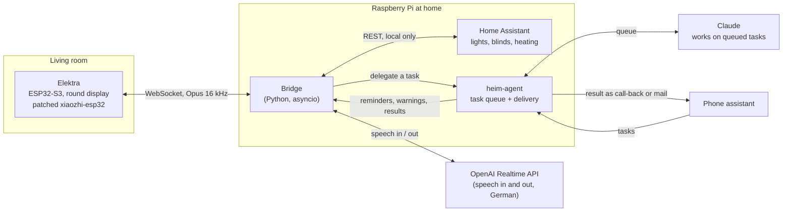

# Elektra

A small voice assistant for a living room, built on an ESP32-S3 with a round
touch display. It is a private, non-commercial hobby project for one household.
The firmware is a patched fork of [xiaozhi-esp32](https://github.com/78/xiaozhi-esp32);
the speech and smart-home logic lives in a separate bridge that is not part of
this repository.

The device is called **Elektra**, and you wake it by saying its name.

## The idea

Most voice assistants answer questions. Elektra is meant to be the part of a
household assistant that sits in the room: you talk to it, it talks back, and
it is also where the rest of the system gets a voice.

The household runs a small stack of its own services on a Raspberry Pi. Elektra
is the speaker and screen for that stack:

- **You talk to it.** Wake word or tap, then free conversation in German
  through the OpenAI Realtime API. It can switch lights and blinds, set the
  thermostat, play internet radio, and read the weather.
- **The house talks to it.** A separate task agent (*heim-agent*) takes
  longer jobs, such as "look this up and tell me later", works on them in the
  background and hands the result back. When the result is ready, Elektra shows
  an envelope on its display, and a tap reads it aloud. Reminders appear as
  a bell. A weather warning is spoken right away, but only between 7 and
  22 o'clock and only when nobody is talking to it.
- **A phone assistant can borrow it.** A second voice assistant, reached by
  telephone, can hand its call over to Elektra so you can talk hands-free in
  the room. That part is still being built.

## How the pieces fit together

The device itself is deliberately dumb. It records, plays, draws the ring and
the icons, and listens for the wake word. Everything that needs a decision
happens in the bridge on the Pi, so firmware changes stay small and the logic
can be tested on a laptop.

## Hardware

- [Waveshare ESP32-S3-Touch-LCD-1.85C](https://www.waveshare.com/esp32-s3-touch-lcd-1.85c.htm):
  round 1.85" display, capacitive touch, battery, ES7210 microphone codec with
  two MEMS microphones, speaker.

## What the display shows

A ring carries the state: listening, speaking, thinking. While the device
sleeps, a moon takes its place. The battery shows up only when it drops below
30 %. Small icons mark waiting messages (envelope) and reminders (bell).

## What is in this repository

Only the firmware changes, as patches against xiaozhi-esp32:

| File | Purpose |
|---|---|
| `01-touch-anmelden.patch` | Touch handling. Applies to a clean tree but not after 03; the build recipe skips it |
| `02-hi-nach-wake-word.patch` + `hi.ogg` | Local "Hi" right after the wake word, no cloud round trip |
| `03-elektra-display.patch` + `elektra_display.*` | Board support, display ring and icons, battery |
| `04-mikrofon-agc.patch` | Two microphones with source separation (AFE `SR` type) instead of one |
| `05-wake-word-schreibweisen.patch` | Several spellings for the custom wake word, score logging |
| `sdkconfig.defaults.rundfunk` | Build configuration |

Build instructions and the pitfalls we ran into are in [`firmware/README.md`](firmware/README.md).

## Wake word: where we are stuck

Espressif ships about 80 ready-made WakeNet models with fixed names. There is
none for "Elektra", so we use the **MultiNet workaround** (`CustomWakeWord`
with the English `mn7_en` command recogniser, six spellings, threshold 4 %).

It works, but not well enough: measured on 20 September 2026, **8 of 10 calls
from 2 m** triggered, with scores of only 4–15 %. A real WakeNet model scores
close to 1.0 on a clean hit. The AFE logs `wakenet model not found` at start.

We would like a WakeNet model for **"Elektra"**. See the request in
[espressif/esp-sr#88](https://github.com/espressif/esp-sr/issues/88).

## Licence

The patches and our own files are MIT licensed, like the upstream project.
xiaozhi-esp32 is MIT licensed (Shenzhen Xinzhi Future Technology Co., Ltd.).
See [`LICENSE`](LICENSE).
